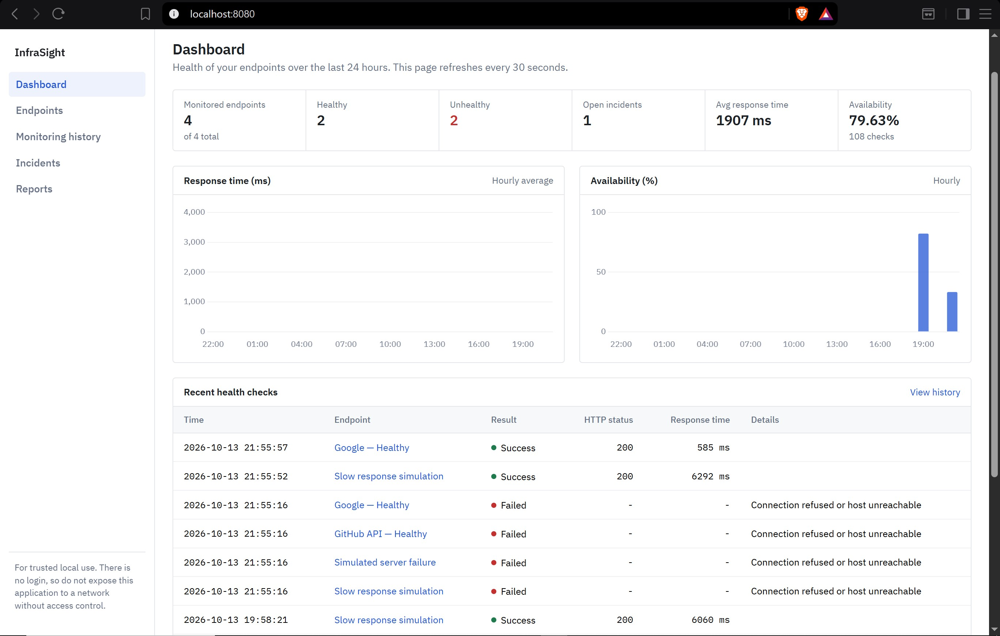
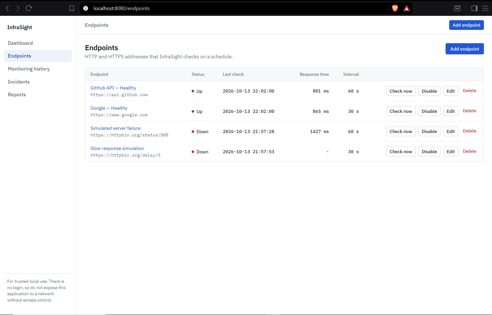
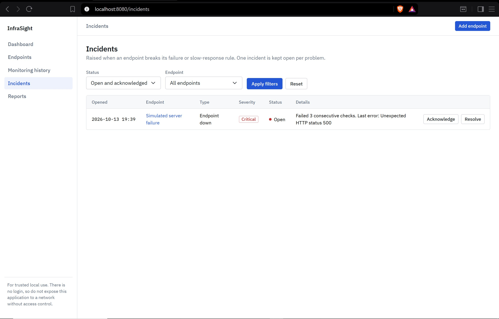
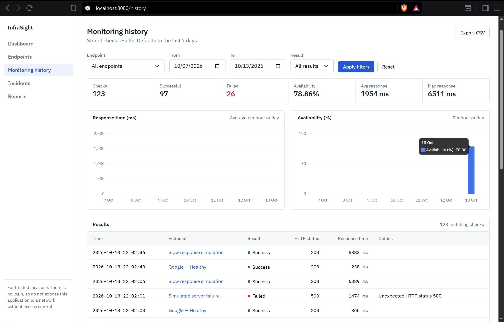

# InfraSight

**InfraSight** is a Spring Boot web application for monitoring HTTP
endpoints, tracking availability and response times, and managing
incidents when checks fail or become slow.

## Features

-   **Endpoint management** --- add and manage endpoints to monitor.
-   **Scheduled health checks** --- periodically send HTTP GET requests
    to configured endpoints.
-   **Availability tracking** --- record successful and failed checks
    over time.
-   **Response-time monitoring** --- track response times and identify
    slow responses.
-   **Incident management** --- raise incidents after consecutive failed
    or slow checks and review incident status.
-   **Monitoring history** --- inspect previous check results.
-   **Reports and trends** --- view monitoring summaries and
    endpoint-level statistics.
-   **Endpoint validation** --- block private, loopback, and link-local
    network destinations to reduce SSRF risk.

## Screenshots









## Technology Stack

-   **Language:** Java
-   **Framework:** Spring Boot
-   **Build tool:** Maven
-   **View layer:** Thymeleaf templates
-   **Frontend:** HTML, CSS, JavaScript
-   **Charts:** Chart.js
-   **UI styling:** Bootstrap

## Run Locally

### Prerequisites

-   A compatible JDK installed (check `pom.xml` for the configured Java
    version)
-   Git
-   Network access if the application uses external services or
    dependencies

### 1. Clone the repository

``` bash
git clone https://github.com/Vishal-1962/InfraSight.git
cd InfraSight
```

### 2. Configure the application

Review:

-   `src/main/resources/application.properties`
-   `.env.example`

Set any required environment variables or local configuration values for
your environment. **Do not put real passwords, tokens, or other secrets
in GitHub.** The `.env.example` file should contain placeholders only.

### 3. Start the application

On Windows PowerShell:

``` powershell
.\mvnw.cmd spring-boot:run
```

Alternatively, if Maven is installed:

``` bash
mvn spring-boot:run
```

If the wrapper script is blocked by the local PowerShell execution
policy, use `.\mvnw.cmd` from Command Prompt or run Maven directly.

### 4. Open InfraSight

Visit:

-   Dashboard: http://localhost:8080/
-   Endpoints: http://localhost:8080/endpoints
-   Monitoring history: http://localhost:8080/history
-   Incidents: http://localhost:8080/incidents
-   Reports: http://localhost:8080/reports

The application must be running locally for these addresses to work.

## Security Notes

-   The current application displays a warning that it is intended for
    trusted local use and has no login.
-   Do not expose this version to the public internet or an untrusted
    network without implementing authentication and appropriate access
    controls.
-   Endpoint monitoring can create SSRF risks. Keep URL validation
    enabled and review security controls before deploying.
-   Use placeholder values in committed configuration files. Never
    commit real credentials.

## Project Structure

``` text
InfraSight/
├── src/
│   └── main/
│       ├── java/com/infrasight/
│       │   ├── config/
│       │   ├── dto/
│       │   ├── entity/
│       │   ├── repository/
│       │   ├── service/
│       │   └── web/
│       └── resources/
│           ├── static/
│           ├── templates/
│           └── application.properties
├── .env.example
├── .gitignore
├── pom.xml
└── RUNNING.txt
```

## Current Scope

InfraSight is currently presented as a locally run monitoring
application. A public deployment should not be considered
production-ready until authentication, authorization, production
configuration, and deployment-specific security have been addressed.

## License

No license has been specified yet. Unless a license is added to this
repository, reuse and redistribution are not automatically permitted.
